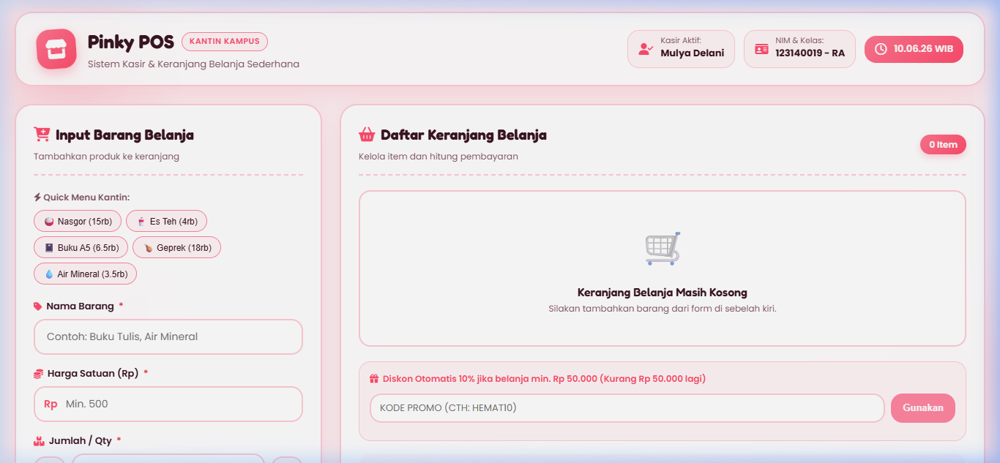
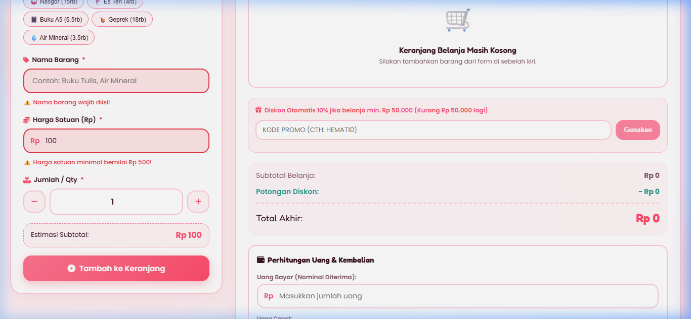
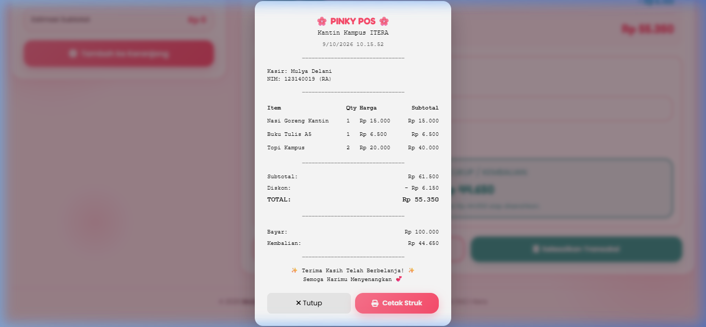

# 🌸 Pinky POS - Aplikasi Kasir & Keranjang Belanja Sederhana (Mini POS)

Tugas Praktikum Pemrograman Aplikasi Web (PAW) - Pertemuan 1  
**Institut Teknologi Sumatera (ITERA)**

---

## 👤 Identitas Mahasiswa

- **Nama Lengkap**: Mulya Delani
- **NIM**: 123140019
- **Kelas Praktikum**: RA
- **Studi Kasus**: Sistem Kasir & Keranjang Belanja Kantin Kampus / Toko Kampus

---

## 📝 Deskripsi Aplikasi

**Pinky POS** adalah aplikasi web Kasir & Keranjang Belanja Sederhana (Mini POS) berbasis JavaScript modern yang dirancang khusus untuk kebutuhan transaksi di kantin atau toko kampus. Aplikasi ini menyatukan tiga kompetensi dasar praktikum PAW:

1. **Validasi Input Form**: Memastikan seluruh data produk (Nama Barang, Harga Satuan, dan Qty) diisi dengan benar sebelum masuk ke keranjang belanja.
2. **Perhitungan Kalkulator Otomatis**: Mengkalkulasi subtotal per barang, akumulasi total belanja, diskon otomatis 10% untuk transaksi Rp 50.000+, serta perhitungan nominal kembalian secara *real-time*.
3. **Manajemen Keranjang Belanja & LocalStorage**: Menyimpan daftar item keranjang secara persisten di browser (`localStorage`), sehingga data transaksi tidak hilang saat halaman di-refresh.

Aplikasi ini dibalut dengan antarmuka **Cute & Modern Pink Theme** yang estetik, responsif, dan interaktif.

---

## 🚀 Panduan Menjalankan Aplikasi

Aplikasi ini dibuat menggunakan standar **HTML5, CSS3 (Vanilla CSS), dan Vanilla JavaScript** tanpa membutuhkan *dependency* atau *framework* berat.

### Cara 1: Menggunakan Live Server di VS Code (Rekomendasi)
1. Buka folder proyek `MulyaDelani_123140019_pertemuan1` di Visual Studio Code.
2. Pastikan ekstensi **Live Server** telah terinstall di VS Code.
3. Klik kanan pada berkas `index.html` (atau berkas latihan di folder `modul/`) dan pilih **Open with Live Server**.
4. Aplikasi akan otomatis terbuka di browser pada alamat `http://127.0.0.1:5500/index.html`.

### Cara 2: Membuka Berkas HTML Langsung
1. Buka file explorer dan masuk ke direktori proyek `MulyaDelani_123140019_pertemuan1`.
2. Klik dua kali (*double click*) pada berkas `index.html` atau file modul latihan di folder `modul/`.
3. Aplikasi akan langsung berjalan di web browser (Google Chrome, Edge, Firefox, atau Safari).

---

## ✨ Daftar Fitur & Checklist Implementasi

### A. Aplikasi Utama Kasir & Keranjang Belanja (Mini POS)
- [x] **Validasi Form Input Barang**:
  - [x] Nama Barang: Wajib diisi, minimal 3 karakter.
  - [x] Harga Satuan: Wajib berupa angka positif dan minimal Rp 500.
  - [x] Qty / Jumlah: Wajib berupa angka bulat minimal 1 (dilengkapi tombol `+` & `-`).
  - [x] Error Feedback: Teks peringatan merah di bawah input yang salah & efek border bergetar (*shake animation*).
  - [x] Reset Form Otomatis setelah barang berhasil ditambahkan.
  - [x] Quick Preset Buttons (Menu Kantin Cepat: Nasi Goreng, Es Teh, Buku A5, Ayam Geprek, Air Mineral).

- [x] **Modul Kalkulator & Perhitungan Otomatis**:
  - [x] Kalkulasi Subtotal per baris (`Harga Satuan × Qty`).
  - [x] Kalkulasi Akumulasi Total Belanja otomatis.
  - [x] Diskon Otomatis 10% jika total belanja mencapai minimal **Rp 50.000**.
  - [x] Fitur Kode Promo Tambahan (contoh: `HEMAT10` / `PINK10`).
  - [x] Input Uang Bayar & Kalkulator Kembalian *real-time* (`Kembalian = Uang Bayar - Total Akhir`).
  - [x] Tombol Nominal Uang Cepat (*Uang Pas, 10rb, 20rb, 50rb, 100rb*).
  - [x] Status Uang Cukup vs Uang Belum Mencukupi.

- [x] **Manajemen Keranjang Belanja & LocalStorage**:
  - [x] Tabel Keranjang Belanja interaktif (*No, Nama Barang, Harga Satuan, Qty, Subtotal, Aksi*).
  - [x] Fitur Hapus Item per baris (otomatis mengkalkulasi ulang total dan diskon).
  - [x] Penyimpanan Persisten LocalStorage (`JSON.stringify` & `JSON.parse`).
  - [x] Tombol Transaksi Baru / Reset untuk menghapus seluruh keranjang & me-reset localStorage.
  - [x] Pop-up Modal Struk Belanja Transaksi (*Receipt Popup*) & Fitur Cetak Struk.

---

### B. Berkas Modul Latihan Praktikum (`modul/`)
- [x] **`modul/latihan1.html`**:
  - Variabel data diri (`const` & `let`).
  - Pengecekan kelulusan (`nilai >= 70`).
  - Pengecekan kategori umur (*Anak, Remaja, Dewasa, Lansia*).
  - Switch-case angka hari ke nama hari bahasa Inggris (1-7).
  - Kalkulator grade nilai dengan ternary operator.
- [x] **`modul/latihan2.html`**:
  - Loop tabel perkalian 1-10 untuk angka pilihan.
  - Fungsi kalkulator faktorial ($n!$).
  - Fungsi cek bilangan prima.
  - Kalkulator BMI (Body Mass Index) + Event Handler.
  - Program FizzBuzz (1-100).
- [x] **`modul/latihan3.html`**:
  - Array minimal 5 objek mahasiswa (*nama, nim, jurusan, nilai*) dalam tabel HTML.
  - Fungsi pencari nilai tertinggi dengan method array (`reduce`).
  - Filter dan penampil mahasiswa di atas rata-rata.
  - Pengurutan nama (*ascending/descending*).
  - Fitur CRUD lengkap (*Create, Read, Update, Delete*) data mahasiswa.
- [x] **`modul/latihan4.html`**:
  - Form input mahasiswa persisten dengan LocalStorage & validasi.
  - Integrasi API Posts (JSONPlaceholder) dengan fitur search/filter.
  - Pagination API dengan tombol *Previous* & *Next*.
  - Dark Mode Toggle berbasis manipulasi class CSS.
  - Aplikasi Todo List (*tambah, hapus, tandai selesai*) dengan LocalStorage.

---

## 📸 Tangkapan Layar (Screenshots)

### 1. Tampilan Utama Aplikasi (Pink Theme & Quick Menu)


### 2. Validasi Error Handling (Form Input Salah)


### 3. Tabel Keranjang, Kalkulator Diskon 10%, Kembalian & Struk Belanja


---

## 🛠️ Penjelasan Teknis Singkat

### 1. Alur Validasi Input Form (`script.js`)
Fungsi `validateForm()` bertugas memverifikasi kelayakan nilai dari masing-masing bidang input sebelum dimasukkan ke dalam *array* `cartState`:
- **Nama Barang**: Diperiksa menggunakan `length < 3` dan `.trim() === ''`.
- **Harga Satuan**: Diperiksa dengan `isNaN(hargaVal)` dan `hargaVal < 500`.
- **Qty**: Diperiksa dengan `Number.isInteger()` dan `qtyVal < 1`.

Jika ditemukan ketidaksesuaian, class CSS `.has-error` akan ditambahkan pada container input untuk memicu pesan teks berwarna merah di bawah elemen input serta animasi getar CSS.

### 2. Algoritma Perhitungan Kalkulator & Diskon
Fungsi `updateCalculators()` secara konsisten dieksekusi setiap kali ada perubahan data keranjang, nominal uang bayar, atau kode promo:
$$\text{Subtotal Belanja} = \sum_{i=1}^{n} (\text{Harga}_i \times \text{Qty}_i)$$

$$\text{Diskon 10\%} = \begin{cases} 
\text{Subtotal} \times 0.10 & \text{jika Subtotal} \ge 50000 \\ 
0 & \text{jika Subtotal} < 50000 
\end{cases}$$

$$\text{Total Akhir} = \max(0, \text{Subtotal} - \text{Total Diskon})$$

$$\text{Kembalian} = \text{Uang Bayar} - \text{Total Akhir}$$

Format tampilan mata uang dikonversi secara konsisten menggunakan API bawaan browser `Intl.NumberFormat('id-ID', { style: 'currency', currency: 'IDR' })`.

### 3. Mekanisme Serialisasi LocalStorage
Data daftar keranjang disimpan sebagai *array of objects* dalam variabel `cartState`.
- **Menyimpan Data**: `localStorage.setItem(STORAGE_KEY, JSON.stringify(cartState))` dipanggil setiap kali ada penambahan atau penghapusan barang.
- **Membaca Data Saat Load**: Pada fungsi `initApp()`, `localStorage.getItem(STORAGE_KEY)` dipanggil dan diurai kembali menggunakan `JSON.parse()`.
- **Reset Data**: Fungsi `resetCartAndStorage()` membersihkan array `cartState = []` dan memanggil `localStorage.removeItem(STORAGE_KEY)`.

---

## 📁 Struktur Directory Proyek

```text
pemrograman_web_itera_123140019/
└── MulyaDelani_123140019_pertemuan1/
    ├── index.html           # Struktur antarmuka aplikasi HTML5 Mini POS
    ├── style.css            # Custom CSS styling (Pink Aesthetic & Glassmorphism)
    ├── script.js            # Logika pemrograman & validasi JavaScript
    ├── README.md            # Dokumentasi lengkap tugas praktikum
    ├── screenshots/         # Folder simpanan berkas screenshot aplikasi
    │   ├── screenshot_main_ui.png
    │   ├── screenshot_validation_error.png
    │   └── screenshot_calculator_receipt.png
    └── modul/               # Folder modul & latihan praktikum
        ├── latihan1.html    # Latihan 1: Dasar JS, Variable, Switch, Ternary
        ├── latihan2.html    # Latihan 2: Loop, Faktorial, Prima, BMI, FizzBuzz
        ├── latihan3.html    # Latihan 3: Array Object, Sort, Filter & CRUD
        └── latihan4.html    # Latihan 4: LocalStorage, API Posts, Dark Mode, Todo List
```

---

*Dikembangkan untuk Tugas Praktikum PAW 2026 | Institut Teknologi Sumatera (ITERA)*
