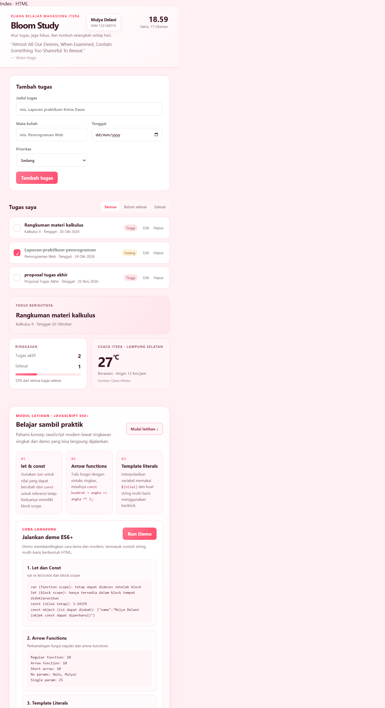

# Bloom Study — Ruang Belajar Mahasiswa ITERA

Bloom Study adalah dashboard personal Mulya Delani (NIM 123140019) untuk membantu mengatur tugas kuliah dan tenggatnya. Data tugas disimpan di `localStorage` browser, sehingga tetap tersedia saat halaman dibuka kembali di browser yang sama.

## Fitur

- Tambah, edit, hapus, dan tandai tugas sebagai selesai/belum selesai.
- Catat mata kuliah, tenggat, dan prioritas; tugas yang terlambat diberi penanda.
- Filter tugas, ringkasan progres, serta fokus pada tenggat aktif terdekat.
- Jam dan tanggal lokal, kutipan acak dari DummyJSON, serta cuaca ITERA dari Open-Meteo.
- Penjelasan ditampilkan jika data lokal bermasalah atau layanan API tidak tersedia.
- Tampilan responsif untuk desktop dan ponsel.

## Screenshot

## Menjalankan

Buka `index.html` di browser modern. Koneksi internet diperlukan untuk memuat kutipan dan cuaca; fungsi daftar tugas tetap dapat digunakan tanpa kedua layanan tersebut.

## Modul latihan

Ringkasan **MODUL LATIHAN · JAVASCRIPT ES6+** dan demo interaktif sudah menjadi bagian dari halaman utama Bloom Study. Gulir ke bagian latihan, lalu tekan **Run Demo** untuk melihat contoh `let`/`const`, arrow functions, concatenation, dan template literals. Materi mandiri tambahan tetap tersedia di [`modul/latihan-template-literals/`](./modul/latihan-template-literals/).

## Implementasi ES6+

Baris merujuk pada `script.js` dan dapat berubah jika kode diperbarui.

| Fitur | Implementasi |
| --- | --- |
| `const` dan `let` | Konstanta konfigurasi dan variabel lokal/state, misalnya baris 1–4, 33, 35, dan 170 |
| Arrow functions (lebih dari 3) | Event handler, `map`, `filter`, `sort`, dan callback, misalnya baris 63, 74, 87, dan 149–168 |
| Template literals | ID cadangan, pesan error, daftar tugas, ringkasan, dan widget, misalnya baris 8, 40, 175, 200, dan 216 |
| Async/await dan Promise | `async loadWidgets()` memakai `await Promise.allSettled()`, baris 240–275 |
| Classes | `TaskItem` dan `DashboardApp`, baris 6 dan 17 |
| Destructuring | Parameter `TaskItem`, `dataset`, kutipan, dan cuaca, baris 7, 101, 255, dan 263 |
| Spread operator | Pembaruan state tugas secara immutable, baris 76, 82, dan 107 |
| Penyimpanan lokal | `loadTasks()` dan `saveTasks()` menggunakan `localStorage`, baris 31–55 |

> `localStorage` terikat pada browser/perangkat yang digunakan dan tidak menyinkronkan data antarperangkat.
