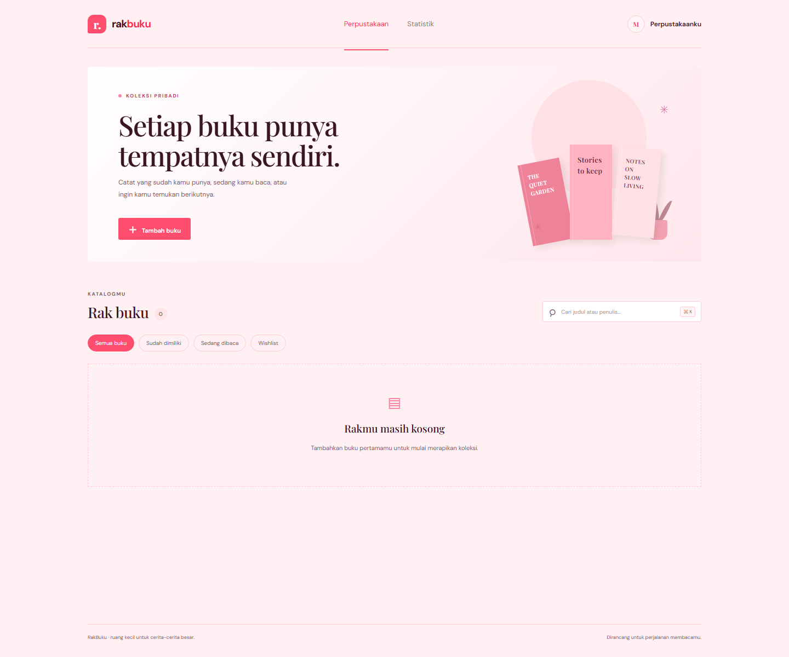
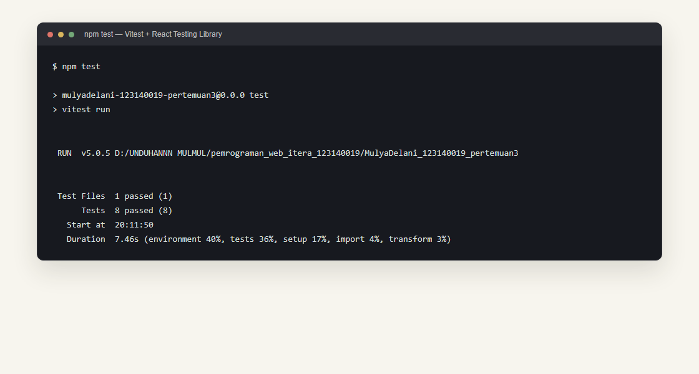

# RakBuku — Aplikasi Manajemen Buku Pribadi

RakBuku adalah aplikasi katalog buku pribadi untuk mencatat buku yang sudah dimiliki, sedang dibaca, atau ingin dibeli. Koleksi tersimpan di `localStorage` browser, sehingga tetap tersedia saat aplikasi dibuka kembali pada browser dan perangkat yang sama.

## Fitur

- Tambah, edit, dan hapus buku.
- Kategori status: **Sudah dimiliki**, **Sedang dibaca**, dan **Ingin dibeli**.
- Filter status serta pencarian berdasarkan judul atau nama penulis.
- Halaman statistik yang merangkum koleksi menurut status.
- Validasi judul dan penulis dengan pesan kesalahan pada kolom yang belum diisi.
- Tampilan responsif untuk layar desktop dan ponsel.
- Tema pink lembut yang konsisten dengan project pertemuan sebelumnya.

## Screenshot antarmuka



## Instalasi dan menjalankan

Pastikan Node.js dan npm tersedia, lalu jalankan perintah berikut dari folder project:

```bash
npm install
npm run dev
```

Buka alamat lokal yang ditampilkan Vite (biasanya `http://localhost:5173`). Untuk membuat build produksi:

```bash
npm run build
npm run preview
```

## Teknologi dan konsep React

- **React + Vite** untuk antarmuka single-page.
- **Functional components dan Hooks:** `useState` mengelola pencarian, filter, dan form; `useEffect` menyimpan perubahan ke `localStorage`.
- **Context API:** `BookProvider` dan `useBooks` berbagi koleksi dan aksi CRUD lintas halaman.
- **React Router:** navigasi antara halaman **Perpustakaan** dan **Statistik**.
- **Custom hooks:** `useLocalStorage` untuk persistensi lokal dan `useBookStats` untuk menghitung ringkasan status.
- **Komponen reusable dengan PropTypes:** form, kartu/daftar buku, filter, header, halaman, dan provider.
- **Testing:** Vitest dan React Testing Library menguji tampilan kosong, validasi, CRUD, pencarian, filter, persistensi, dan statistik.

## Laporan pengujian

Jalankan unit test dengan:

```bash
npm test
```

Ringkasan hasil eksekusi terakhir di terminal:



```text
Test Files  1 passed (1)
Tests       8 passed (8)
```

Hasil verifikasi lainnya:

| Pemeriksaan | Hasil |
| --- | --- |
| Unit test React Testing Library | 8 tes |
| Production build | Berhasil |
| Oxlint | Berhasil |

## Catatan penyimpanan

Data `localStorage` hanya tersedia di browser/perangkat yang digunakan dan tidak disinkronkan antarperangkat. Jika browser menolak penyimpanan, aplikasi menampilkan pemberitahuan agar perubahan tidak disangka sudah tersimpan.

## Modul latihan React

Project Task Manager untuk latihan Components & Props, State & Hooks, React Router, dan Context API tersedia secara terpisah di [`modul/`](./modul/). Baca [`modul/README.md`](./modul/README.md) untuk langkah instalasi dan menjalankannya.
