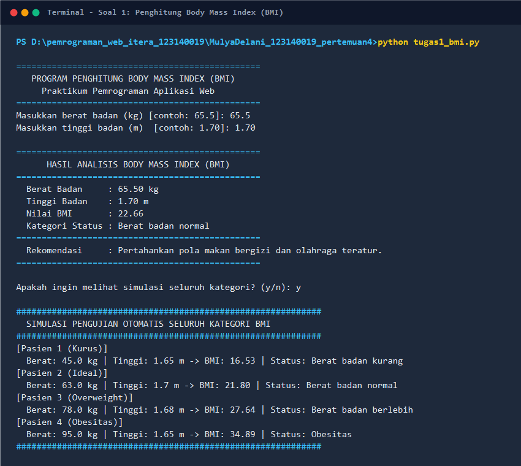
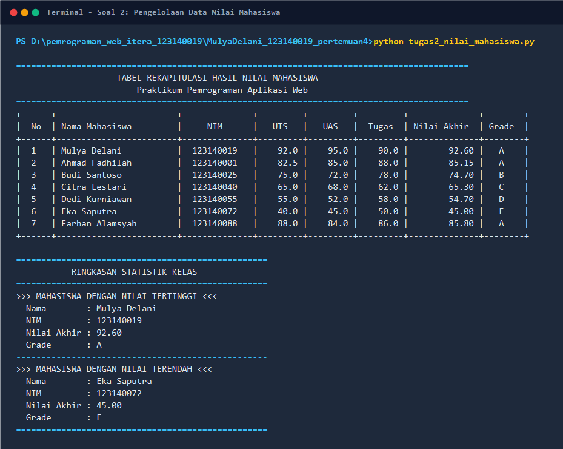
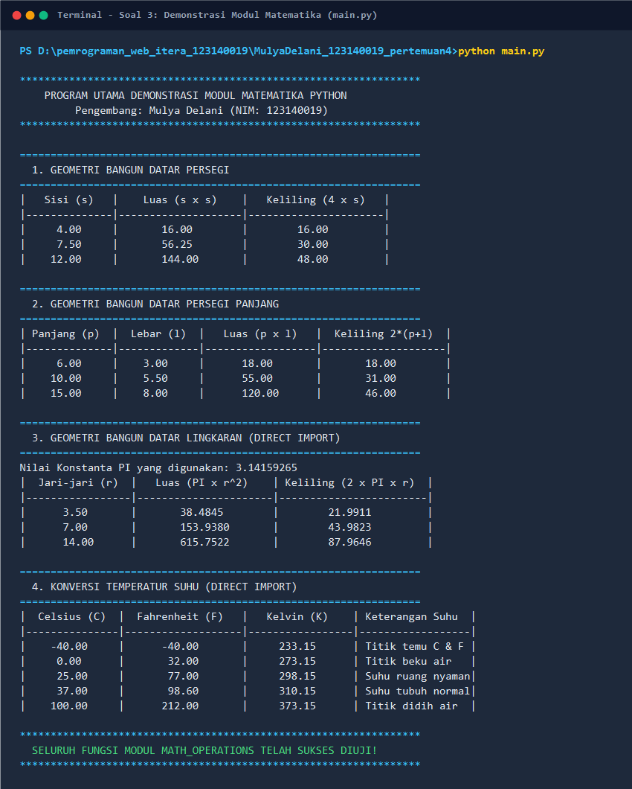

# 🐍 Praktikum Pemrograman Aplikasi Web (PAW) — Pertemuan 4: Python Dasar

Repository praktikum ini berisi penyelesaian tugas mandiri dan seluruh modul latihan untuk **Pertemuan 04: Python Dasar & Pemrograman Berorientasi Objek Sederhana** di Program Studi Teknik Informatika, Institut Teknologi Sumatera (ITERA).

---

## 👤 Identitas Praktikan

- **Nama Lengkap** : Mulya Delani
- **NIM**          : 123140019
- **Kelas**        : Praktikum Pemrograman Aplikasi Web (PAW)
- **Program Studi**: Teknik Informatika
- **Institusi**    : Institut Teknologi Sumatera (ITERA)

---

## 📂 Struktur Direktori Proyek

```text
MulyaDelani_123140019_pertemuan4/
├── .gitignore                          # Konfigurasi pengabaian file cache (__pycache__, venv, dll.)
├── README.md                           # Dokumentasi komprehensif praktikum
├── generate_terminal_screenshots.ps1   # Skrip pembantu pembuat screenshot terminal
├── tugas1_bmi.py                       # Soal 1: Program Penghitung BMI Sederhana (Bobot 30%)
├── tugas2_nilai_mahasiswa.py           # Soal 2: Program Pengelolaan Data Nilai Mahasiswa (Bobot 40%)
├── math_operations.py                  # Soal 3: Modul Geometri & Konversi Suhu (Bobot 30%)
├── main.py                             # Soal 3: Program Utama Pemanggil Modul math_operations
│
├── screenshots/                        # Bukti eksekusi terminal (format PNG)
│   ├── soal1_bmi.png                   # Screenshot hasil eksekusi tugas1_bmi.py
│   ├── soal2_nilai_mahasiswa.png       # Screenshot hasil eksekusi tugas2_nilai_mahasiswa.py
│   └── soal3_math_operations.png       # Screenshot hasil eksekusi main.py
│
└── modul/                              # Seluruh Berkas Hands-on & Latihan Mandiri Materi Kuliah
    ├── README.md                       # Dokumentasi khusus modul praktikum
    ├── 01_pengenalan.py                # Hands-on 1: Sintaks dasar, print(), sep, end, escape
    ├── latihan1.py                     # Latihan 1: Profil diri, sep=' | ', kartu identitas berbingkai #
    ├── 02_variabel.py                  # Hands-on 2: Tipe data, casting, f-string, input()
    ├── latihan2_suhu.py                # Latihan 2: Kalkulator konversi Celsius ke F & K
    ├── 03_kendali.py                   # Hands-on 3: if-elif-else, ternary, for, while, break
    ├── latihan3_tebak.py               # Latihan 3: Game tebak angka rahasia sederhana
    ├── 04_fungsi.py                    # Hands-on 4: def, default arg, *args, **kwargs, lambda
    ├── latihan4_validasi.py            # Latihan 4: Fungsi validator password (panjang & angka)
    ├── 05_struktur_data.py             # Hands-on 5: List, Tuple, Dictionary, Set
    ├── latihan5_kontak.py              # Latihan 5: Aplikasi katalog kontak telepon sederhana
    ├── kalkulator_lib.py               # Modul Hands-on 6: Pustaka fungsi aritmatika
    ├── 06_modul_app.py                 # Hands-on 6: Penggunaan modul standar & kustom
    ├── password_gen.py                 # Modul Latihan 6: Generator password acak (random + string)
    └── main_password.py                # Pengujian modul generator password acak
```

---

## 📋 Deskripsi Program Tugas

### 1. Soal 1 — Program Penghitung BMI Sederhana (`tugas1_bmi.py`)
- **Bobot**: 30%
- **Deskripsi**:
  Program untuk menghitung indeks massa tubuh (Body Mass Index / BMI) berdasarkan berat badan (kg) dan tinggi badan (m). Program menyediakan interaktivitas input dari konsol serta mode simulasi otomatis untuk memvalidasi keempat kategori status berat badan.
- **Formula**:
  $$\text{BMI} = \frac{\text{berat}}{\text{tinggi}^2}$$
- **Kategori Status Percabangan (`if-elif-else`)**:
  - $\text{BMI} < 18.5$ : **Berat badan kurang**
  - $18.5 \le \text{BMI} < 25.0$ : **Berat badan normal**
  - $25.0 \le \text{BMI} < 30.0$ : **Berat badan berlebih**
  - $\text{BMI} \ge 30.0$ : **Obesitas**
- **Fungsi Utama**:
  - `hitung_bmi(berat: float, tinggi: float) -> float`: Menghitung nilai BMI dengan validasi input positif.
  - `tentukan_kategori_bmi(bmi: float) -> str`: Mengklasifikasikan kategori BMI dengan percabangan bertingkat.
  - `cetak_kartu_hasil(...)`: Mencetak kartu hasil analisis dengan rekomendasi pola hidup sehat.
  - `jalankan_demo_pengujian()`: Menguji secara otomatis sampel data untuk setiap kategori BMI.

---

### 2. Soal 2 — Pengelolaan Data Nilai Mahasiswa (`tugas2_nilai_mahasiswa.py`)
- **Bobot**: 40%
- **Deskripsi**:
  Program berbasis list of dictionaries yang mengelola data nilai akademik 7 mahasiswa (melebihi batas minimal 5 mahasiswa). Program menghitung nilai akhir dengan bobot terstandar, menentukan grade huruf (A sampai E), menyajikan tabel rapi berbingkai ASCII, serta mendeteksi nilai tertinggi dan terendah menggunakan fungsi bawaan `max()` dan `min()` dengan *lambda expression*.
- **Formula Pembobotan**:
  $$\text{Nilai Akhir} = (30\% \times \text{UTS}) + (40\% \times \text{UAS}) + (30\% \times \text{Tugas})$$
- **Kriteria Grade Nilai**:
  - **A** : $\text{Nilai Akhir} \ge 80$
  - **B** : $70 \le \text{Nilai Akhir} < 80$
  - **C** : $60 \le \text{Nilai Akhir} < 70$
  - **D** : $50 \le \text{Nilai Akhir} < 60$
  - **E** : $\text{Nilai Akhir} < 50$
- **Fungsi Utama**:
  - `hitung_nilai_akhir(uts, uas, tugas) -> float`: Menghitung nilai akhir terbobot.
  - `tentukan_grade(nilai_akhir) -> str`: Memetakan skor numerik ke grade huruf A–E.
  - `proses_data_mahasiswa(daftar_mahasiswa) -> list`: Memperkaya list dictionary dengan nilai akhir dan grade.
  - `tampilkan_tabel_mahasiswa(daftar_mahasiswa) -> None`: Menampilkan tabel presisi dengan perataan *f-string*.
  - `cari_ekstrem_nilai(daftar_mahasiswa) -> tuple`: Menemukan mahasiswa dengan nilai tertinggi dan terendah.

---

### 3. Soal 3 — Modul Matematika & Program Utama (`math_operations.py` & `main.py`)
- **Bobot**: 30%
- **Deskripsi**:
  Implementasi arsitektur kode modular berbasis file modul terpisah (`math_operations.py`) dan berkas eksekusi utama (`main.py`). Memenuhi seluruh kriteria konvensi PEP 8, memiliki *docstring* lengkap pada setiap fungsi, dan menyertakan pengujian internal modul menggunakan idiomatik `if __name__ == '__main__':`.
- **Fitur pada `math_operations.py` (Modul)**:
  - **Konstanta**: `PI = 3.141592653589793`
  - **Geometri Bangun Datar**:
    - `luas_persegi(sisi)` & `keliling_persegi(sisi)`
    - `luas_persegi_panjang(panjang, lebar)` & `keliling_persegi_panjang(panjang, lebar)`
    - `luas_lingkaran(jari_jari)` & `keliling_lingkaran(jari_jari)`
  - **Konversi Temperatur Suhu**:
    - `celsius_ke_fahrenheit(celsius)`: $F = (C \times 9/5) + 32$
    - `celsius_ke_kelvin(celsius)`: $K = C + 273.15$
- **Fitur pada `main.py` (Program Utama)**:
  - **Menerapkan 2 Teknik Impor Berbeda**:
    1. *Module Aliasing*: `import math_operations as mo`
    2. *Direct Import*: `from math_operations import PI, luas_lingkaran, keliling_lingkaran, celsius_ke_fahrenheit, celsius_ke_kelvin`
  - Menguji dan mendemonstrasikan **SELURUH** fungsi yang ada di modul matematika dengan beragam input nilai pengujian.

---

## 🚀 Panduan Eksekusi Program di Terminal

Buka terminal pada direktori proyek `MulyaDelani_123140019_pertemuan4`:

```bash
cd MulyaDelani_123140019_pertemuan4
```

### 1. Menjalankan Soal 1 (Penghitung BMI)
```bash
python tugas1_bmi.py
```
*Masukkan berat badan (contoh: `65.5`) dan tinggi badan (contoh: `1.70`). Pilih `y` saat ditanya untuk melihat simulasi seluruh kategori.*

### 2. Menjalankan Soal 2 (Pengelolaan Nilai Mahasiswa)
```bash
python tugas2_nilai_mahasiswa.py
```
*Program akan memproses 7 data mahasiswa, mencetak tabel rekapitulasi nilai lengkap, dan menampilkan mahasiswa peraih nilai tertinggi serta terendah.*

### 3. Menjalankan Soal 3 (Demonstrasi Modul Matematika)
```bash
python main.py
```
*Program utama akan memanggil seluruh fungsi dari `math_operations.py` menggunakan 2 teknik impor dan menyajikan tabel hasil perhitungan geometri dan konversi temperatur.*

### 4. Menguji Modul Matematika Mandiri (Self-Test Modul)
```bash
python math_operations.py
```

### 5. Menjalankan Berkas Latihan Mandiri di Direktori `modul/`
```bash
# Pindah ke direktori modul
cd modul

# Latihan 1: Identitas diri & kartu berbingkai
python latihan1.py

# Latihan 2: Kalkulator suhu interaktif
python latihan2_suhu.py

# Latihan 3: Game tebak angka rahasia
python latihan3_tebak.py

# Latihan 4: Validasi kekuatan password
python latihan4_validasi.py

# Latihan 5: Aplikasi kontak telepon (Dictionary)
python latihan5_kontak.py

# Latihan 6: Generator password acak
python main_password.py

# Kembali ke folder utama
cd ..
```

---

## 📸 Bukti Hasil Eksekusi Program (Screenshots)

### 1. Hasil Eksekusi Soal 1 (`tugas1_bmi.py`)


---

### 2. Hasil Eksekusi Soal 2 (`tugas2_nilai_mahasiswa.py`)


---

### 3. Hasil Eksekusi Soal 3 (`main.py` & `math_operations.py`)


---

## 💡 Konvensi Kode & Kepatuhan Standar PEP 8

Seluruh kode dalam repositori ini dibangun dengan mematuhi kaidah standar Python:
1. **Indentasi Konsisten**: Menggunakan tepat 4 spasi untuk setiap blok kode bersarang (tanpa karakter *tab* tercampur).
2. **Penamaan Berbasis Snake Case**: Seluruh nama fungsi, variabel, dan berkas menggunakan gaya `snake_case` (contoh: `hitung_nilai_akhir`, `daftar_mahasiswa`).
3. **Dokumentasi Lengkap (Docstring)**: Setiap fungsi dilengkapi *triple-quoted string* (`"""..."""`) yang merinci tujuan fungsi, deskripsi parameter, tipe kembalian (*return type*), serta potensi galat (*exception*).
4. **Type Annotations**: Menerapkan *type hints* modern (seperti `float`, `str`, `List`, `Dict`, `Tuple`) untuk menjaga kejelasan tipe data dan mencegah bug *runtime*.
5. **Separation of Concerns & Modularity**: Memisahkan logika komputasi murni dari logika *Input/Output (I/O)* dan antarmuka CLI.

