# Praktikum Pemrograman Web ITERA - Pertemuan 5

**Nama:** Mulya Delani  
**NIM:** 123140019  
**Kelas praktikum:** RA

## Isi folder

- `01_everything_is_object.py` - tipe objek, method string, dan fungsi sebagai objek.
- `01_procedural_vs_oop.py` - perbandingan pendekatan prosedural dan OOP.
- `02_class_object.py` - atribut class/instance dan dunder methods.
- `03_inheritance.py` - inheritance, overriding, dan multiple inheritance.
- `04_encapsulation.py` - atribut public/protected/private serta `@property`.
- `05_polymorphism.py` - overriding, duck typing, dan operator overloading.
- `06_abstraction.py` - abstract class, shape, dan interface konektor database.
- `latihan_*.py` - jawaban latihan mandiri pada materi.
- `tugas_perpustakaan/` - sistem perpustakaan sebagai tugas praktikum akhir.
- `Screenshoot/` - 13 gambar output terminal untuk semua hands-on, latihan, dan tugas.

## Penerapan konsep OOP pada sistem perpustakaan

- **Class dan object:** `LibraryItem`, `Book`, `Magazine`, dan `Library`.
- **Inheritance:** `Book` dan `Magazine` mewarisi `LibraryItem`.
- **Abstraction:** `LibraryItem` mewajibkan subclass menyediakan `get_detail()`.
- **Encapsulation:** status peminjaman item dan koleksi perpustakaan disimpan sebagai atribut private.
- **Polymorphism:** katalog memanggil `get_detail()` tanpa perlu mengetahui jenis item.
- **Property:** `is_dipinjam`, `item_id`, dan `judul` menyediakan akses atribut terkontrol.

## Menjalankan program

Gunakan Python 3.10 atau lebih baru. Jalankan perintah dari folder ini:

```powershell
python 01_everything_is_object.py
python 01_procedural_vs_oop.py
python 02_class_object.py
python 03_inheritance.py
python 04_encapsulation.py
python 05_polymorphism.py
python 06_abstraction.py
python latihan_entitas_toko.py
python latihan_buku.py
python latihan_karyawan.py
python latihan_storage.py
python -m MulyaDelani_123140019_pertemuan5.tugas_perpustakaan.main
```

Jalankan latihan truk sebagai modul dari folder induk repository agar impor tetap valid:

```powershell
python -m MulyaDelani_123140019_pertemuan5.latihan_truk
```

## Bukti screenshot

Folder `Screenshoot/` berisi gambar output terminal untuk setiap program yang dijalankan:

- `01_everything_is_object.png` dan `01_procedural_vs_oop.png`
- `02_class_object.png`, `03_inheritance.png`, `04_encapsulation.png`
- `05_polymorphism.png`, `06_abstraction.png`
- `latihan_entitas_toko.png`, `latihan_buku.png`, `latihan_truk.png`
- `latihan_karyawan.png`, `latihan_storage.png`
- `tugas_perpustakaan.png` - penambahan item, pencarian, peminjaman, dan katalog.

Gambar berikut menampilkan perintah serta output hasil eksekusi program.

### Hands-on

#### Everything is an Object

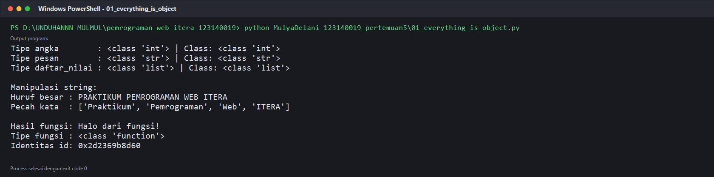

#### Perbandingan Prosedural dan OOP

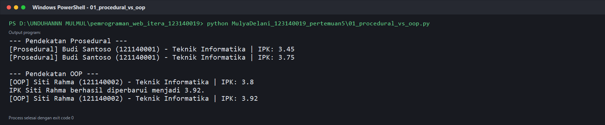

#### Class dan Object

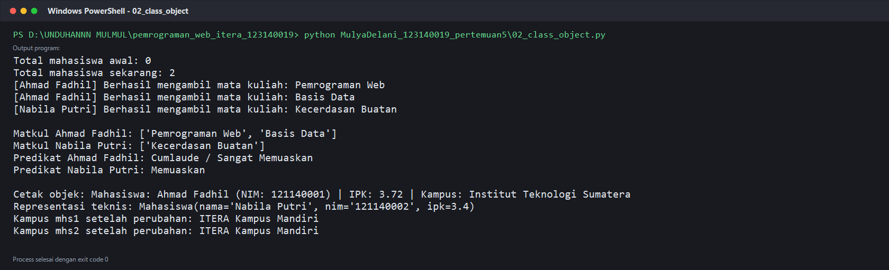

#### Inheritance

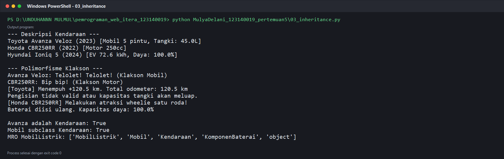

#### Encapsulation

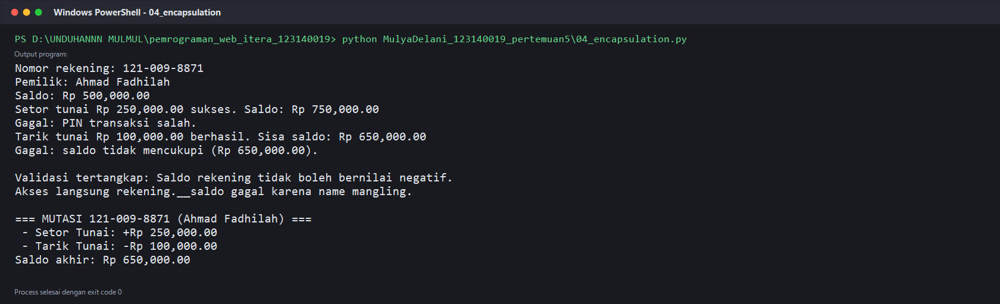

#### Polymorphism

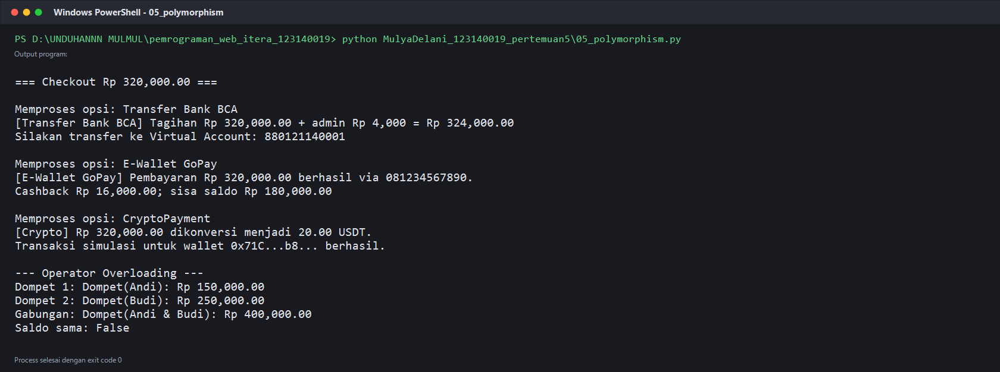

#### Abstraction

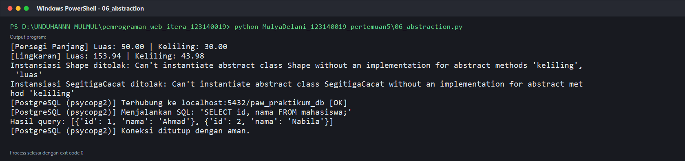

### Latihan mandiri

#### Pemodelan Entitas Toko

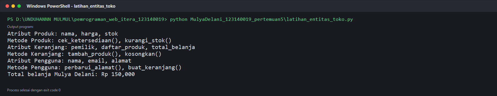

#### Class Buku

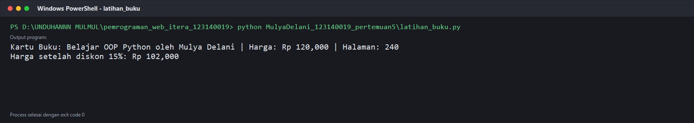

#### Armada Truk

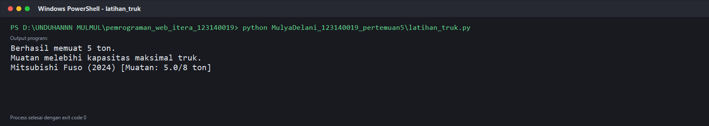

#### Penggajian Karyawan

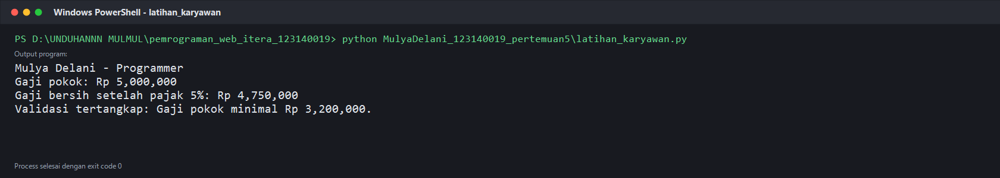

#### File Storage

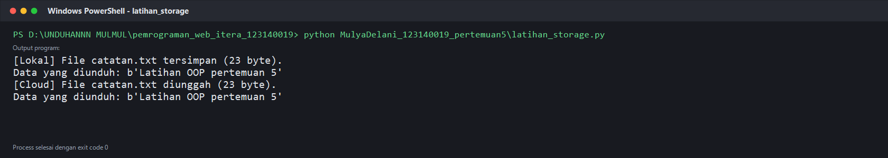

### Tugas praktikum: Sistem Perpustakaan

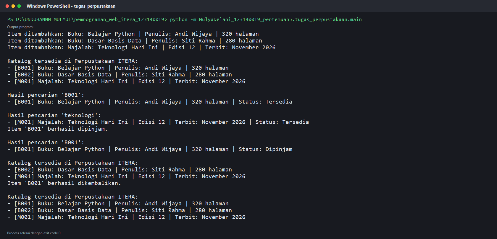
